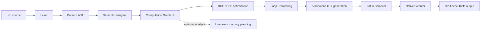

<p align="center">
  
</p>

<h1 align="center">⚒️ ForgeCC</h1>

<p align="center">
  A small, ahead-of-time tensor expression compiler that turns a custom source language into native C++20 CPU executables.
</p>

<p align="center">
  
  
  
</p>

---

## 📚 Table of Contents

- [Project Overview](#-project-overview)
- [Key Capabilities](#-key-capabilities)
- [Compiler Architecture](#-compiler-architecture)
- [Language and Functional Requirements](#-language-and-functional-requirements)
- [Quick Start](#-quick-start)
  - [Requirements](#requirements)
  - [Configure, build, and test](#configure-build-and-test)
  - [Compile and execute a program](#compile-and-execute-a-program)
- [Project Modules and Internal Design](#-project-modules-and-internal-design)
- [Development Roadmap](#-development-roadmap)
- [Correctness and Testing](#-correctness-and-testing)
- [Performance Engineering and Benchmark Results](#-performance-engineering-and-benchmark-results)
- [Technology Stack](#-technology-stack)
- [Design Decisions and Trade-offs](#-design-decisions-and-trade-offs)
- [Current Scope and Limitations](#-current-scope-and-limitations)
- [Future Directions](#-future-directions)

## 🎯 Project Overview

ForgeCC is a portfolio-scale compiler project for exploring how tensor programs move from source text to executable CPU code. A program such as `out = relu(matmul(A, B) + bias)` is lexed, parsed into an AST, checked for identifiers and shapes, lowered into a computation graph, optimized, converted into explicit loop-oriented IR, emitted as C++, compiled with the system C++ compiler, and executed.

That makes ForgeCC different from a conventional tensor library. A library provides prewritten operations over runtime tensors; ForgeCC compiles a small tensor language and exposes the intermediate representations, analyses, transformations, and backend boundaries involved in producing native code. The implementation is intentionally small enough to inspect while still covering compiler frontend, IR, optimization, systems integration, correctness testing, and performance measurement.

## 🧩 Key Capabilities

- Custom `.fcc` tensor language with declarations, assignments, calls, parentheses, and binary arithmetic expressions.
- C++20 lexer, recursive-descent parser, AST, source locations, and diagnostics.
- Semantic analysis for `f32` tensors, identifier resolution, operation arity, and tensor-shape inference.
- Computation Graph IR with values, producers, consumers, graph inputs, outputs, validation, dumps, and topological traversal.
- Graph optimization infrastructure with dead-code elimination and common-subexpression elimination.
- Loop-oriented IR for loops, tensor indexing, arithmetic, unary ReLU, stores, and tiled matrix multiplication.
- Graph-to-loop lowering with deterministic value-to-tensor mappings.
- Memory liveness analysis and deterministic intermediate-buffer planning with reuse checks.
- Native C++20 emission, standalone executable wrapping, safe Linux compiler invocation, and direct executable execution.
- Independent numerical correctness tests, end-to-end examples, CPU benchmarks, CSV samples, and Markdown performance reports.
- Opt-in tiled matrix multiplication with configurable tile sizes 8, 16, and 32.

## 🏗️ Compiler Architecture



The active driver pipeline is:

| Stage              | Responsibility                                                                                            | Relevant module                                                                                                                                                          |
| ------------------ | --------------------------------------------------------------------------------------------------------- | ------------------------------------------------------------------------------------------------------------------------------------------------------------------------ |
| Source input       | Reads the complete `.fcc` file and retains its path and contents.                                         | [`src/cli/source_file.cpp`](src/cli/source_file.cpp), [`include/forgecc/driver/compiler.hpp`](include/forgecc/driver/compiler.hpp)                                       |
| Lexing             | Converts identifiers, literals, punctuation, operators, and EOF into tokens.                              | [`include/forgecc/frontend/lexer.hpp`](include/forgecc/frontend/lexer.hpp)                                                                                               |
| Parsing            | Builds expressions, assignments, declarations, and complete programs.                                     | [`include/forgecc/frontend/parser.hpp`](include/forgecc/frontend/parser.hpp), [`include/forgecc/frontend/ast.hpp`](include/forgecc/frontend/ast.hpp)                     |
| Semantic analysis  | Registers tensors, resolves identifiers, validates operations, and infers shapes.                         | [`include/forgecc/frontend/semantic_analyzer.hpp`](include/forgecc/frontend/semantic_analyzer.hpp), [`include/forgecc/semantic/`](include/forgecc/semantic/)             |
| Graph construction | Converts the AST into values and operation nodes while preserving dependencies.                           | [`include/forgecc/lowering/lowerer.hpp`](include/forgecc/lowering/lowerer.hpp), [`src/lowering/lowerer.cpp`](src/lowering/lowerer.cpp)                                   |
| Graph optimization | Runs validated optimization passes, currently DCE and CSE.                                                | [`include/forgecc/optimizer/pass_manager.hpp`](include/forgecc/optimizer/pass_manager.hpp), [`include/forgecc/optimizer/`](include/forgecc/optimizer/)                   |
| Loop lowering      | Produces explicit loop IR in dependency order; supports baseline and opt-in tiled matmul.                 | [`include/forgecc/lowering/loop_lowerer.hpp`](include/forgecc/lowering/loop_lowerer.hpp), [`include/forgecc/lowering/loop_ir.hpp`](include/forgecc/lowering/loop_ir.hpp) |
| Memory planning    | Computes value lifetimes and plans reusable intermediate buffers.                                         | [`include/forgecc/memory/memory_plan.hpp`](include/forgecc/memory/memory_plan.hpp)                                                                                       |
| C++ generation     | Emits readable C++20 for graph or loop IR; standalone emission adds `main()`, initialization, and output. | [`src/codegen/cpp_emitter.cpp`](src/codegen/cpp_emitter.cpp), [`src/codegen/standalone_emitter.cpp`](src/codegen/standalone_emitter.cpp)                                 |
| Native compilation | Writes generated source to a temporary file and invokes `g++` through a POSIX process boundary.           | [`src/native/native_compiler.cpp`](src/native/native_compiler.cpp)                                                                                                       |
| Execution          | Runs the resulting binary directly and captures stdout, stderr, and exit status.                          | [`src/native/native_executor.cpp`](src/native/native_executor.cpp)                                                                                                       |

The current `CompilerDriver` coordinates the active source-to-executable path from lexing through native execution. Memory planning is implemented and tested as an independent analysis component, but it is not yet consumed by the end-to-end driver or used to rewrite generated storage. This keeps the current backend behavior explicit while leaving a clean integration point for later work.

## 🧾 Language and Functional Requirements

ForgeCC currently supports one tensor element type, `f32`, with statically declared dimensions:

```text
A: f32[2, 2]
B: f32[2, 2]
bias: f32[2, 2]
out = relu(matmul(A, B) + bias)
```

The language supports:

- Tensor declarations such as `A: f32[128, 256]`.
- Assignments such as `out = A + B`.
- Identifiers and parenthesized expressions.
- Function calls `relu(x)` and `matmul(a, b)`.
- Binary tensor arithmetic: `+`, `-`, `*`, and `/`.
- Rank-2 matrix multiplication with compatible inner dimensions.

Semantic analysis checks declared identifiers, duplicate declarations, operation arity, elementwise shape compatibility, matrix-multiplication ranks and dimensions, and recursively inferred expression shapes.

Standalone executables currently initialize every input tensor deterministically with the sequence `[-1, 2, -3, 4, ...]`, print output elements one per line, and exit. Arbitrary interactive or file-based runtime tensor input is not supported yet. Numeric literals are lexed and parsed, but they are not currently lowered as tensor-graph values.

## 🚀 Quick Start

### Requirements

- Linux or another POSIX-like environment for the current native process implementation.
- A C++20 compiler, typically `g++`.
- CMake 3.20 or newer.
- Ninja is selected by the default CMake preset.

### Configure, build, and test

```sh
git clone https://github.com/Sumdiboii/forgecc-tensor-compiler.git
cd forgecc-tensor-compiler
cmake --preset default -DFORGECC_BUILD_TESTS=ON -DFORGECC_BUILD_BENCHMARKS=ON
cmake --build build -j2
ctest --test-dir build --output-on-failure
```

The repository's latest verification reports 5/5 CTest tests passing. The main `forgecc_tests` executable contains the broader unit, lowering, native-execution, and correctness coverage; the remaining CTest entries exercise CLI and report-generator integration.

### Compile and execute a program

The CLI accepts:

```text
forgecc compile <input.fcc> [-o <output>]
```

The output directory must already exist. For example:

```sh
mkdir -p build/e2e
./build/forgecc compile examples/e2e/combined.fcc \
  -o build/e2e/combined
./build/e2e/combined
```

The `compile` command runs the complete current pipeline and also executes the generated binary. It prints the program's numeric output followed by the executable location. The standalone generated C++ source is temporary and removed after native compilation; the executable remains at the requested output path.

## 🧱 Project Modules and Internal Design

| Area                                                       | Design focus                                                                                                            |
| ---------------------------------------------------------- | ----------------------------------------------------------------------------------------------------------------------- |
| [`include/forgecc/frontend/`](include/forgecc/frontend/)   | Source-language tokens, lexer, AST, parser, and semantic analyzer.                                                      |
| [`include/forgecc/semantic/`](include/forgecc/semantic/)   | `TensorType`, `ElementType::F32`, and the declaration symbol table.                                                     |
| [`include/forgecc/ir/`](include/forgecc/ir/)               | Graph values, operation nodes, validation, topological traversal, printing, and mutation APIs used by optimization.     |
| [`include/forgecc/optimizer/`](include/forgecc/optimizer/) | Pass interface, pass manager, DCE, and CSE. Passes validate the graph before and after transformations.                 |
| [`include/forgecc/lowering/`](include/forgecc/lowering/)   | Graph lowering plus a separate loop-oriented representation for indexing, expressions, stores, loops, and tiled matmul. |
| [`include/forgecc/memory/`](include/forgecc/memory/)       | Topological lifetime analysis and deterministic buffer-capacity planning for intermediate values.                       |
| [`include/forgecc/codegen/`](include/forgecc/codegen/)     | Source emission, graph/Loop IR C++ emission, and standalone executable wrappers.                                        |
| [`include/forgecc/native/`](include/forgecc/native/)       | Safe compiler-process invocation and direct POSIX executable execution.                                                 |
| [`include/forgecc/driver/`](include/forgecc/driver/)       | Orchestrates the source-to-executable pipeline and propagates stage diagnostics.                                        |
| [`benchmarks/`](benchmarks/)                               | Reproducible CPU workloads, raw CSV measurements, and Markdown report generation.                                       |
| [`tests/`](tests/)                                         | Unit tests, CTest integration, independent numerical references, and native execution checks.                           |

The graph IR and Loop IR deliberately have different responsibilities. The graph captures tensor-operation dependencies; the Loop IR makes iteration, indexing, and stores explicit for CPU code generation. This separation allows graph-level transformations and loop-oriented lowering to evolve independently.

## 🗺️ Development Roadmap

ForgeCC was implemented incrementally from frontend foundations to native execution:

| Phase                                      | Completed scope                                                                                                                    |
| ------------------------------------------ | ---------------------------------------------------------------------------------------------------------------------------------- |
| Phase 2 — Frontend                         | Lexer, tokens, source locations, diagnostics, parser, AST, expressions, declarations, and program parsing.                         |
| Phase 3 — Semantic analysis                | `f32` tensor types, symbol-table foundations, identifier and operation validation, shape inference, and compatibility diagnostics. |
| Phase 4 — Computation Graph IR             | Graph values and nodes, graph validation/dumps, topological traversal, and AST-to-graph lowering.                                  |
| Phase 5 — Graph optimization               | Pass infrastructure, validation around passes, dead-code elimination, and common-subexpression elimination.                        |
| Phase 6 — CPU backend foundations          | C++ source-emission infrastructure and operation-aware CPU code generation for graph/Loop IR.                                      |
| Phase 7 — Loop lowering and memory         | Loop-oriented IR, graph-to-loop lowering, liveness analysis, and intermediate buffer planning/reuse.                               |
| Phase 8 — Native compilation and execution | CLI foundation, generated-source compilation with the system C++ compiler, standalone wrapping, and direct executable execution.   |
| Phase 9 — Correctness and benchmarking     | Independent numerical references, end-to-end correctness tests, reproducible CPU benchmarks, CSV samples, and Markdown reports.    |
| Phase 10 — Advanced CPU optimization       | Baseline matmul, opt-in tiled matmul, and measured comparison of tile sizes and workloads.                                         |

The repository history includes the staged implementation commits for these milestones. The exact implementation order of code-generation and loop-lowering work evolved as the backend was made executable, but the resulting component boundaries remain explicit.

CUDA/GPU support is optional future work and has deliberately not been implemented.

## ✅ Correctness and Testing

Testing covers both isolated compiler components and real native execution:

- Lexer, parser, AST, diagnostics, and semantic-analysis tests validate normal and malformed source programs.
- Graph, optimization, Loop IR, lowering, memory planning, and code-generation tests inspect actual intermediate structures and invariants.
- Native compiler tests cover successful compilation and compiler failures.
- Correctness tests compare generated executable output with independent C++ reference calculations for elementwise arithmetic, ReLU, rectangular matmul, and combined expressions.
- CLI and report-generator integration are registered with CTest.

The latest project verification reports **5/5 CTest tests passed**. This is distinct from the broader set of tests invoked inside `forgecc_tests`.

The additional end-to-end fixtures under [`examples/e2e/`](examples/e2e/) are:

| Fixture                                                         | Purpose                                                             |
| --------------------------------------------------------------- | ------------------------------------------------------------------- |
| [`addition.fcc`](examples/e2e/addition.fcc)                     | Elementwise addition.                                               |
| [`relu.fcc`](examples/e2e/relu.fcc)                             | ReLU over negative, positive, and zero-valued deterministic inputs. |
| [`matmul_rectangular.fcc`](examples/e2e/matmul_rectangular.fcc) | Rectangular matrix multiplication.                                  |
| [`combined.fcc`](examples/e2e/combined.fcc)                     | Matrix multiplication, bias addition, and ReLU.                     |
| [`larger_rectangular.fcc`](examples/e2e/larger_rectangular.fcc) | Larger rectangular computation.                                     |
| [`invalid_shape.fcc`](examples/e2e/invalid_shape.fcc)           | Invalid matrix dimensions and semantic diagnostics.                 |

The five valid fixtures compiled into native executables and produced exact matches against independently calculated expected outputs. The invalid fixture failed with `matmul inner dimensions are incompatible`, returned a nonzero status, and did not produce an executable.

## 📈 Performance Engineering and Benchmark Results

The benchmark executable in [`benchmarks/cpu_benchmarks.cpp`](benchmarks/cpu_benchmarks.cpp) compares equivalent deterministic workloads using:

1. A straightforward C++ baseline.
2. Graph IR after the existing DCE/CSE passes.
3. Baseline Loop IR code generation.
4. Tiled Loop IR with tile sizes 8, 16, and 32.

The Phase 10.3 run used five warmup iterations and thirty measured iterations. Timing starts immediately around each operation call, excludes input setup, output formatting, and native compilation, and uses checksums to keep results observable. The CSV retains every raw sample plus average, median, minimum, maximum, compilation time, source size, executable size, and speedup metadata.

Representative verified matmul medians from [`phase10_3_performance_report.md`](benchmarks/results/phase10_3_performance_report.md), in nanoseconds:

| Workload |    Baseline |      Tiled-8 |     Tiled-16 |     Tiled-32 |
| -------- | ----------: | -----------: | -----------: | -----------: |
| 8×8      |     4,477.5 |      6,911.0 |      4,249.0 |      3,717.0 |
| 16×16    |    37,734.0 |     51,725.0 |     46,095.5 |     30,978.5 |
| 32×32    |   163,129.0 |    234,260.0 |    239,154.0 |    196,520.5 |
| 64×64    | 1,223,030.0 |  2,038,702.5 |  1,759,274.5 |  1,578,633.5 |
| 128×128  | 9,648,330.0 | 14,946,083.5 | 14,082,816.0 | 12,828,010.0 |

The measurements show that tile size 32 was generally the strongest tiled configuration in this run. Tiled-32 beat the straightforward baseline for 8×8 and 16×16, but tiled implementations did not beat that baseline for 32×32 or larger tested workloads. Tiling also improved substantially over the current baseline Loop IR in several cases, although that comparison is separate from the straightforward baseline. The results demonstrate why optimization choices need measurement: tiling adds boundary and loop overhead, and its benefit depends on working-set size, dimensions, compiler output, and the host machine.

The expected locality motivation is that baseline `B[k, j]` accesses stride through row-major storage, while the tiled loop processes bounded blocks and advances across columns of `B` and `C` contiguously in its inner loop. The report does not claim measured cache improvements. `perf` was available, but hardware event access was denied by `perf_event_paranoid=4`; no cache-miss, cycle, or instruction-count measurements were collected.

Raw measurements are available in [`phase10_3_cpu_benchmarks.csv`](benchmarks/results/phase10_3_cpu_benchmarks.csv), and the regeneration commands are documented in [`benchmarks/README.md`](benchmarks/README.md).

## 🛠️ Technology Stack

| Technology           | Role                                                                          |
| -------------------- | ----------------------------------------------------------------------------- |
| C++20                | Compiler, IR, backend, CLI support, tests, and reference calculations.        |
| CMake 3.20+          | Project configuration and target organization.                                |
| Ninja                | Default generator in [`CMakePresets.json`](CMakePresets.json).                |
| CTest                | Build-integrated unit, CLI, and report-generator tests.                       |
| Standard C++ library | Filesystem, containers, process-adjacent utilities, timing, and formatting.   |
| Linux/POSIX APIs     | Safe `fork`/`exec`, pipes, `waitpid`, and direct native executable execution. |
| System C++ compiler  | Native compilation of generated C++20; `g++` is the default.                  |

## ⚖️ Design Decisions and Trade-offs

- **Separate IRs:** the computation graph represents dependencies and tensor operations; Loop IR represents explicit iteration and memory accesses. This makes graph optimization independent from backend loop structure.
- **Validated boundaries:** graph validation, pass-manager validation, Loop IR validation, and native compiler result checks prevent later stages from silently consuming malformed data.
- **Opt-in tiling:** tiled matmul is selected through `LoopLowererOptions` rather than replacing the baseline. This preserves a measurable reference implementation and makes tile-size trade-offs visible.
- **Independent correctness:** expected outputs come from simple reference calculations rather than reusing generated kernels, reducing the chance that the same bug exists in both the implementation and its test oracle.
- **Compilation versus execution:** native compilation is intentionally separate from executable execution, so compiler diagnostics and steady-state kernel timings are not conflated.
- **Explicit current limits:** memory planning is available as a standalone analysis/planning component but is not yet integrated into the active driver storage path. That boundary avoids pretending that planned buffer reuse already changes generated execution.

## 🚧 Current Scope and Limitations

- CPU backend only; there is no CUDA or GPU backend.
- Only `f32` tensors are supported.
- Supported operations are ReLU, rank-2 matrix multiplication, and elementwise `+`, `-`, `*`, and `/`.
- Standalone inputs use deterministic initialization; arbitrary runtime tensor loading is not implemented.
- Generated C++ source is temporary and removed after native compilation, so persistent generated-source inspection is not currently part of the CLI workflow.
- Memory planning validates lifetimes and buffer reuse decisions but is not yet connected to executable storage allocation.
- The native process implementation targets Linux/POSIX behavior and uses the system C++ compiler.
- Benchmark results are environment-specific. Hardware-counter access was unavailable in the recorded environment.

## 🔭 Future Directions

- Integrate memory-plan allocations into generated storage and execution.
- Add more tensor operations and richer runtime input handling.
- Preserve generated C++ as an optional inspection artifact.
- Add additional CPU optimization strategies and broader workload analysis.
- Explore a CUDA backend only after the CPU pipeline and measurements justify it.

---

## Notice

Built with the help of AI pair-programming to move faster on syntax, with all architecture, problem-solving, and final code decisions handled by me.

---

<p align="center">
  <strong>Sumdiboii</strong><br />
  <a href="https://www.linkedin.com/in/sumedh-pimplikar">LinkedIn</a>
</p>

